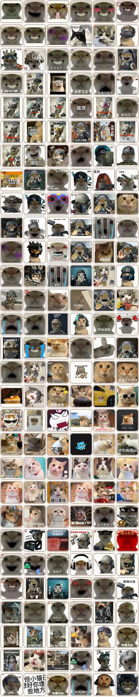

# 哈基米桌宠 · Hajimi Desktop Pet

一只住在桌面上的哈基米：**背景全透明、无边框、始终置顶**。点一下它就换一张梗图，同时"叮"地放一句哈基米/曼波的原声，还会蹦一下。



三种玩法：

- **梗图模式（默认）**：`memes/` 里有 **54 张**哈基米猫梗图，点击逐张切换，每张渲染成圆角贴纸。
- **手绘模式**：9 个表情、5 种台词气泡，全部用 Pillow 现场画出来。
- **音效**：切换时自动播放，27 个音效：**9 段来自 HajimiPad 音效板第一板块**（私人笑声×3、哈基米×2、南北绿豆、曼波、wow、欧耶），6 段酷我抓的哈基米原声，其余 12 个是代码合成的猫叫/呼噜/弹跳声。

## 快速开始

双击 **`start_hajimi.bat`**（无控制台窗口）：

```bat
start_hajimi.bat                 :: 梗图 + 音效
python hajimi_pet.py --mode draw :: 手绘猫
python hajimi_pet.py --mute      :: 静音启动
```

首次启动出现在屏幕右下角，位置、大小、静音状态都会记住。

## 怎么玩

| 操作 | 效果 |
| --- | --- |
| **单击** | 切到下一张梗图 / 下一个表情，**同时放音效**（真实哈基米片段轮流播） |
| 按住拖动 | 挪到任意位置 |
| 滚轮 | 放大 / 缩小（0.6× ~ 1.6×） |
| 右键 | 下一个 / 随机 / 梗图·手绘切换 / **音效开关** / 自动切换 / 缩放 / 关于 / 退出 |
| 中键 | 随机换一张 |

## 音效是怎么来的

| 类别 | 数量 | 来源 |
| --- | --- | --- |
| 音效板第一板块 | 9 段 × 0.8~1.8s | `tools/import_pad_sounds.py`：从 HajimiPad 抓第一个板块的 m4a → ffmpeg 转 wav → 统一音量（点击时优先播这些） |
| 哈基米 / 曼波原声 | 6 段 × 3.4s | `tools/make_hajimi_sounds.py`：酷我搜索"哈基米 曼波"→ 下载 mp3 → ffmpeg 解码 → 自动挑能量最高的一段 → 淡入淡出、统一音量存成 wav |
| 合成音效 | 12 个 | `hajimi_sound.py`：短喵、撒娇喵、长喵呜、哈基米唱歌、呼噜、惊讶叽、弹跳、啵、星星音、呜咽、低吼、嘿嘿笑，全部 numpy 共振峰合成 |

- 梗图模式下每点一次就轮换一段真实原声（`hajimi_01..06`），4 秒内连点会打断上一段，不会叠音。
- 手绘模式下"心动/开心/得意"三个表情用真实原声，其余用合成音效（生气=低吼、困困=呼噜、哭哭=呜咽…）。
- 右键菜单可以一键静音，状态记在 `%APPDATA%\hajimi-pet.json`。
- 音效文件都在 `sounds/`，格式是 22.05kHz 单声道 WAV，`winsound` 异步播放，不占 GUI 线程。

## 换成自己的梗图 / 音效

- **图**：图片丢进 `memes/`（jpg/png/webp/bmp），文件名排序就是切换顺序；`captions.txt` 可以给每张配台词气泡。
- **音效**：把自己的 wav 放成 `sounds/hajimi_07.wav`、`hajimi_08.wav`…… 会自动被收录进轮换。
- **重新抓图**：`python tools/fetch_memes_more.py --count 20`（360 图库，自动按感知哈希去重）
- **重新抓音频**：`python tools/make_hajimi_sounds.py --count 6`（需要先 `python tools/get_ffmpeg.py` 把 ffmpeg 取到 `.build/`）

## 命令行参数

| 参数 | 说明 |
| --- | --- |
| `--mode meme/draw` | 梗图 / 手绘，默认有梗图就用梗图 |
| `--memes 目录` | 梗图目录，默认 `./memes` |
| `--mute` | 静音启动 |
| `--scale` `--expr` `--pos` | 初始缩放 / 序号 / 位置 |
| `--auto` | 启动即开启自动切换（每 12 秒） |
| `--log 路径` | 事件写成 JSONL（启动/切换/音效/模式/退出） |
| `--preview 目录` | 生成预览图、演示 GIF 后退出 |
| `--selftest 目录` | 进程内跑一遍交互（含音效）并输出 `report.json` |

## 文件结构

```
hajimi-pet/
├─ hajimi_pet.py           主程序：窗口、交互、动画、音效触发、自测、预览
├─ hajimi_memes.py         梗图贴纸：等比缩放 + 白边留白 + 圆角
├─ hajimi_art.py           手绘形象：剪影、五官、花斑、气泡
├─ hajimi_sound.py         合成 12 个猫音效 + 播放（winsound 异步）
├─ memes/                  174 张梗图 + sources.json（来源 URL）
├─ sounds/                 27 个 wav（9 段音效板 + 6 段原声 + 12 个合成）+ 来源记录
├─ start_hajimi.bat        双击启动
├─ preview/                梗图九宫格、窗口效果、两套演示 GIF、音效频谱图
├─ verify/                 自测报告 + 真实窗口截图
└─ tools/                  抓图、抓音频、ffmpeg 下载、截图、检查脚本
```

## 实现要点

1. **透明置顶窗口**：`overrideredirect` + `-topmost` + `-transparentcolor #ff00ff`（WS_EX_LAYERED 颜色键）。合成时 alpha 二值化但保留原 RGB，边缘不会出现粉色描边。
2. **贴纸渲染**：`ImageOps.pad` 等比缩放留白，避免把梗图上的字裁掉；圆角用遮罩实现。
3. **音效链路**：mp3 在这台机器上 MCI 播不了（MCI MPEG 驱动初始化失败），所以抓下来先用 ffmpeg 转成 wav，再用 `winsound` 播——不依赖任何解码库。
4. **省电**：呼吸/浮动 2px 量化 + 帧签名，画面没变化就不重绘；静止约 4.5% 单核。
5. **事件只绑顶层**：Tk bindtags 已含顶层，子控件点击会冒泡，不会重复触发。

## 验证记录

`verify/` 是本机实测（Windows 11 / Python 3.12 / Tk 8.6），**12 项全部 PASS**：

| 检查 | 结果 |
| --- | --- |
| 连点三次切换 | `meme_01 → 02 → 03 → 04` ✅ |
| 拖动 60px | 只移动窗口、不切换 ✅ |
| 滚轮缩放 | 1.000 → 1.060 ✅ |
| 连点 174 次 | 正好回到起点 ✅ |
| 渲染 | 每帧生成 Tk 图像 424×479 ✅ |
| 音效文件 | 27 个（音效板 9 段 + 原声 6 段）✅ |
| 点击触发音效 | `hajimi_04 → hajimi_05` ✅ |
| 静音 | 静音后不播放 ✅ |

- `verify/shots/*.png`：`PrintWindow` 抓的**真实窗口**画面（不是离屏渲染），能看到不同的梗图。
- 声音：`winsound` 同步播放实测 3.49s / 3.45s / 0.33s，与文件时长一致，说明真的送到音频设备了。
- 频谱：`preview/hajimi_sound_check.png` 里 6 段原声都有稳定的节拍和低频，不是静音或噪声。
- 窗口属性：`400×452`、`topmost=True`、`layered=True`、颜色键 `0xFF00FF`。

## 关于素材

- 梗图和音频都是脚本从公开搜索结果（360 图库 / 酷我音乐）抓的，仅供个人桌面娱乐；来源 URL 分别记在 `memes/sources.json` 和 `sounds/hajimi_sources.json`。要公开发布或商用请换成自己有版权的素材。
